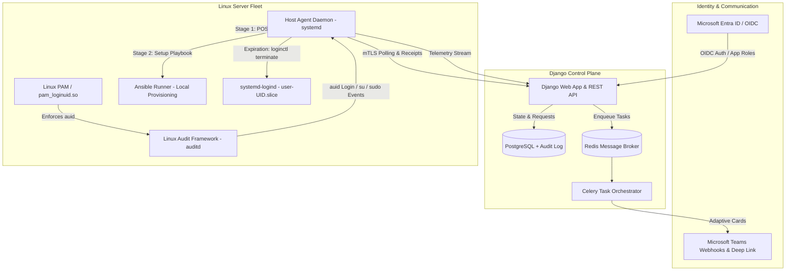
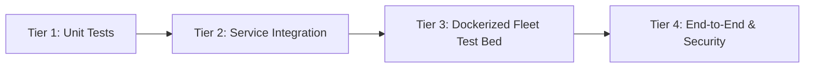
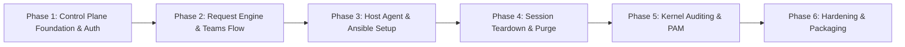

# Just-In-Time (JIT) Linux Access Management Platform
## Technical Specification, Implementation Roadmap & Testing Framework

---

## 1. Executive Overview & Architectural Principles

The JIT Linux Access Management Platform enables temporary, audited, and strictly time-bounded access to a fleet of Linux servers without relying on persistent administrative accounts or central root SSH private keys.

### Core Architectural Planes

1. **Centralized Control Plane (Django)**
   - Identity Provider (IdP) integration via Microsoft Entra ID (OIDC) and Entra App Roles (`Access.Admin` and `Access.User`).
   - Mandatory SSH public key onboarding and cryptographic validation.
   - Fleet inventory, host group hierarchy, and range resolver (e.g., `compute-[01:50].internal`).
   - Access request finite state machine (FSM), multi-channel notifications (Email, MS Teams Webhooks), and direct MS Teams chat deep linking.
   - Asynchronous job scheduling (Celery + Redis) and tamper-evident audit logging (`django-simple-history`).

2. **Execution & Telemetry Plane (Distributed Host Agent)**
   - Lightweight Python daemon running as a `systemd` service on each managed Linux target.
   - Zero incoming network ports: Agent communicates outbound with the Control Plane over mutual TLS (mTLS).
   - 2-Stage Provisioning:
     1. POSIX user creation (`useradd`), `authorized_keys` deployment (mode 0600), and `/etc/sudoers.d` configuration (mode 0440).
     2. Admin-defined Ansible playbook execution via `ansible-runner` for customized developer tooling and workspace setup.
   - Active session termination (`loginctl terminate-user` tearing down `user-<uid>.slice` + `pkill -9`).
   - 3–5 day grace period tracking and irreversible filesystem/account purge (`userdel -rf`).
   - Kernel-level audit telemetry (`auditd` + `pam_loginuid.so`) capturing immutable Audit UIDs (`auid`) across `su` and `sudo` privilege escalation.

---

## 2. Testing Philosophy & Test Bed Strategy

Testing is a first-class requirement across all development phases. The testing framework consists of four testing tiers:

### Testing Tiers

| Tier | Scope | Framework / Tools | Focus |
|---|---|---|---|
| **Tier 1: Unit Tests** | Isolated models, utilities, serializers, parsers, and state machine transitions | `pytest`, `pytest-django`, `unittest.mock` | Validation rules, crypto fingerprinting, range expansion, FSM integrity |
| **Tier 2: Integration Tests** | Database interactions, Celery task execution, API views, mock OIDC flows | `pytest-django`, `responses`, `factory_boy` | OIDC claim extraction, token mapping, webhook dispatches, mTLS auth |
| **Tier 3: Containerized Fleet Tests** | Real Linux environment behavior of the Host Agent | Docker / Testcontainers (`rockylinux:9`, `ubuntu:24.04`, `debian:12`), `systemd-in-docker` | `useradd`, PAM `pam_loginuid`, `loginctl`, `ansible-runner`, `auditd` event parsing |
| **Tier 4: E2E & Security Tests** | Full cycle: Request $\to$ Approval $\to$ Host Provision $\to$ Expiration $\to$ Purge | `docker-compose`, synthetic SSH clients (`paramiko`), `pytest` | Privilege escalation detection, session termination, network partition recovery, replay prevention |

---

## 3. Phase-by-Phase Roadmap, Specifications & Expected Outcomes

---

### Phase 1: Control Plane Foundation & Identity/SSH Key Onboarding

#### 1. Scope & Deliverables
- **Django Core Setup**: PostgreSQL configuration, Celery worker + Redis integration, settings segregation (dev, test, prod).
- **Microsoft Entra ID (Azure AD) OIDC Integration**:
  - Exchange claims using `django-allauth` / `msal`.
  - Extract `oid` (unique ID), `upn` / `email` (notifications and Teams targeting), and map `roles` claim (`Access.Admin` $\to$ Django staff/admin, `Access.User` $\to$ standard user).
  - Sanitization of `preferred_username` into strict POSIX compliant username: regex `^[a-z_][a-z0-9_-]{1,31}$`. Handle conflicts via deterministic numerical suffixing.
- **Mandatory SSH Public Key Middleware**:
  - Middleware intercepts all authenticated HTTP requests.
  - If a user has no verified public key, immediately redirects to `/onboarding/ssh-key/`.
  - Validation engine: inspect key using `cryptography` library / `ssh-keygen -lf`. Enforce whitelist: `ssh-ed25519` or `rsa-sha2-512` ($\ge$ 3072-bit). Disallow `ssh-dss` and weak RSA.
  - Store raw key text, format, comment, and SHA-256 fingerprint.
- **Fleet Inventory Models**:
  - `Host`: hostname, IP/FQDN, OS distribution, agent status, public mTLS certificate fingerprint, last heartbeat.
  - `HostGroup`: hierarchical group tagging (e.g., `production`, `gpu-nodes`).
  - `RangeParser`: utility converting ranges like `gpu-[01:10].internal` into discrete host records.

#### 2. Testing Specification
- **Unit Tests (`tests/test_onboarding.py`, `tests/test_range_parser.py`)**:
  - Regex test suite for username sanitization (special characters, uppercase, leading digits, length boundaries).
  - Cryptographic validator tests: reject 1024-bit RSA, reject DSA, accept Ed25519, accept 4096-bit RSA.
  - SHA-256 fingerprint calculation verification against known `ssh-keygen` outputs.
  - Range parsing unit tests: single host, bracketed ranges (`node-[01:05]`), multiple comma-separated ranges, invalid syntax error handling.
- **Integration Tests (`tests/test_auth_flow.py`)**:
  - Mock OIDC callback with synthetic Entra ID tokens containing various `roles` claims.
  - Middleware redirection assertions: unverified user redirected; verified user accesses target view.
  - Database constraint tests: unique username, unique fingerprint per active key.

#### 3. Expected Outcome & Acceptance Criteria
> **Outcome**: A deployed Django control plane where users authenticate via Azure AD, receive automatic role mapping, are strictly forced to upload and cryptographically validate an SSH key, and administrators can register hosts and host groups.
>
> **Definition of Done (DoD)**:
> 1. All unit and integration tests pass with $\ge 90\%$ branch coverage.
> 2. Zero access granted to platform views until valid Ed25519/RSA key is uploaded.
> 3. Range parser expands complex expressions without crashing or duplicate creation.

---

### Phase 2: Access Request Engine, Review Workflow & Teams Integration

#### 1. Scope & Deliverables
- **Access Request Finite State Machine (FSM)**:
  - States: `PENDING` $\to$ `APPROVED` $\to$ `ACTIVE` $\to$ `EXPIRED_LOCKED` $\to$ `PURGED` (or `DENIED`).
  - Fields: Requester foreign key, SSH Key fingerprint snapshot, fleet targets (Host / HostGroup / Range), UTC Start DateTime, UTC End DateTime, Access Level (`NORMAL` vs `SUDO`), Justification/Motivation text.
  - Extension request support: Request extension while in `ACTIVE` state; transitions to `EXT_PENDING`.
- **Notification Subsystem**:
  - Celery background task triggered upon `PENDING` request creation.
  - Microsoft Teams Webhook dispatches Adaptive Card JSON containing request metadata and action buttons.
  - Email notification fallback via Django mailer.
- **Admin Review Dashboard & Teams Deep Link**:
  - Admin view displaying pending requests, requester past access history, and target machine details.
  - One-click approve/deny actions with audit trail recording.
  - Teams Deep Link URL generator button:
    `https://teams.microsoft.com/l/chat/0/0?users=<upn>&topicName=Access%20Request%20%23<id>&message=Regarding%20your%20access%20request%20for%20<hosts>`

#### 2. Testing Specification
- **Unit Tests (`tests/test_fsm.py`, `tests/test_teams_link.py`)**:
  - FSM transition rules: Verify legal transitions; verify that illegal transitions (e.g., `PENDING` $\to$ `PURGED`) raise `TransitionNotAllowed`.
  - Time window validator: `end_datetime > start_datetime`, maximum allowed duration enforcement (e.g., $\le 7$ days).
  - Teams deep link URL encoder: correctly formats special characters, spaces, and multi-host strings.
- **Integration Tests (`tests/test_notifications.py`)**:
  - Mock HTTP transport verifying Adaptive Card schema compliance and payload accuracy.
  - Celery task execution with `CELERY_TASK_ALWAYS_EAGER = True`.
  - Concurrency tests: Ensure two admins cannot double-approve the same request simultaneously (optimistic locking / DB `select_for_update`).

#### 3. Expected Outcome & Acceptance Criteria
> **Outcome**: Users can submit single or multi-host access requests for specified time windows and privilege levels. Admins receive automated notifications, can initiate an instant 1-click Teams chat with the requester, and review/approve requests through an audited interface.
>
> **Definition of Done (DoD)**:
> 1. Complete test suite for all FSM transition permutations.
> 2. Adaptive card JSON validated against Microsoft schema.
> 3. Concurrent review race conditions handled without state inconsistency.

---

### Phase 3: Host Agent & Customizable Ansible Provisioning Pipeline

#### 1. Scope & Deliverables
- **Host Agent Architecture**:
  - Autonomous Python daemon running as a `systemd` service (`jit-host-agent.service`).
  - Mutual TLS (mTLS) authentication: Agent possesses a unique client certificate signed by the platform Internal CA.
  - Outbound polling loop (configurable, default 15s) against Django Control Plane REST API for scheduled or active jobs.
- **Account Setup Profiles**:
  - Admin-configurable profiles in Django: default login shell, supplementary groups (e.g. `docker`, `dialout`), template skeleton directory.
  - Linked Ansible Playbook repository / playbook file stored in control plane or pulled from Git.
- **2-Stage Provisioning Execution Engine**:
  - **Stage 1 (POSIX Setup)**:
    - `useradd -m -s <shell> -c "JIT Access: <upn>" <username>`
    - Create `/home/<username>/.ssh` with permissions `0700`.
    - Write public key to `/home/<username>/.ssh/authorized_keys` with permissions `0600` and ownership `<username>:<username>`.
    - If `SUDO` requested: write atomic `/etc/sudoers.d/<username>` file (mode `0440`), verified using `visudo -cf`.
  - **Stage 2 (Ansible Customization)**:
    - Execute playbook using `ansible-runner` or `ansible-playbook -i localhost, -c local`.
    - Supply structured extra variables: `target_user`, `access_level`, `request_id`.
    - Capture execution logs and report signed status receipt back to Django.

#### 2. Testing Specification
- **Unit Tests (`agent/tests/test_provisioner.py`)**:
  - Mock subprocess calls for `useradd`, `usermod`, `visudo`, and file operations.
  - Sudoers syntax generator: ensure correct privilege syntax (`<username> ALL=(ALL) NOPASSWD: ALL` or custom passwordless commands).
- **Containerized Integration Tests (`tests/test_agent_docker.py`)**:
  - Spin up Docker containers running Ubuntu 24.04 and Rocky Linux 9 with `systemd` enabled.
  - Run agent inside container against a mock control plane API.
  - Verify actual OS changes: verify `/etc/passwd` entry, verify permissions on `~/.ssh/authorized_keys`, verify `sudo` execution without password prompt when authorized.
  - Run actual Ansible playbook inside container (e.g., creating a file, configuring environment variable) and assert success.

#### 3. Expected Outcome & Acceptance Criteria
> **Outcome**: When a request enters its active time window, the target host agent autonomously creates the POSIX user account, sets strict SSH permissions, provisions sudoers if approved, and runs custom Ansible playbooks, reporting execution success back to Django.
>
> **Definition of Done (DoD)**:
> 1. Agent runs cleanly as a non-interactive daemon under `systemd`.
> 2. Zero root private keys stored or exposed on the Django control plane.
> 3. Automated Docker integration tests pass across both Debian-based and RHEL-based environments.

---

### Phase 4: Account Lifecycle, Session Teardown & Irreversible Purge

#### 1. Scope & Deliverables
- **Immediate Expiration & Lockout**:
  - When `now >= end_datetime`:
    - Lock system account: `usermod -L -e 1 <username>`.
    - Remove SSH access: delete or blank out `/home/<username>/.ssh/authorized_keys`.
    - Revoke sudo access: remove `/etc/sudoers.d/<username>`.
    - Terminate sessions: invoke `loginctl terminate-user <username>` to tear down `user-<uid>.slice`.
    - Force kill any remaining orphan processes: `pkill -9 -u <username>`.
- **In-Session Extensions & Re-Access**:
  - In-session extension updates `end_datetime` in DB; agent updates local timer with zero user disruption.
  - Re-access within the 3–5 day grace period: unlocks account (`usermod -U -e ""`), reinstalls `authorized_keys`, leaving existing workspace intact.
- **Irreversible 3–5 Day Purge Engine**:
  - Agent evaluates expiration timestamp and `/var/log/wtmp` / `lastlog`.
  - Once inactivity threshold (e.g., 96 hours) is reached without active access:
    - Permanently delete user and directory: `userdel -rf <username>`.
    - Wipe user mail spool and crontab.
    - Return cryptographically signed purge receipt to Django.
    - Transition state in Django to `PURGED`.

#### 2. Testing Specification
- **Unit Tests (`agent/tests/test_lifecycle.py`)**:
  - Expiration detector logic and mock clock time-travel tests.
  - Sudoers and authorized_keys cleanup routines.
- **Containerized Teardown Tests (`tests/test_session_teardown_docker.py`)**:
  - In a Dockerized Linux target, spawn an active SSH or background process (e.g. `sleep 9999` or detached `tmux` session) under the JIT user.
  - Trigger expiration lock.
  - Assert that all child processes of the user are terminated (`ps aux | grep <username>` returns 0 user processes).
  - Assert SSH connection with previously authorized key fails immediately (`Permission denied (publickey)`).
- **Purge Verification Tests (`tests/test_purge_docker.py`)**:
  - Advance time past the 96-hour threshold.
  - Run the purge worker.
  - Assert `/home/<username>` is completely removed.
  - Assert `/etc/passwd` and `/etc/shadow` contain no trace of the user.

#### 3. Expected Outcome & Acceptance Criteria
> **Outcome**: Access is terminated the second a time window closes, with all interactive terminals, background processes, and `tmux`/`screen` multiplexers forcefully killed. After the grace period, data is irrecoverably deleted.
>
> **Definition of Done (DoD)**:
> 1. No orphan background processes survive session termination.
> 2. Existing workspace remains preserved if re-accessed within grace period.
> 3. Zero residual data remains on host disk post-purge.

---

### Phase 5: Kernel-Level Auditing (`auditd` + PAM) & Compliance Dashboard

#### 1. Scope & Deliverables
- **PAM & Immutable Audit UID (`auid`) Configuration**:
  - Ensure `pam_loginuid.so` is enabled in `/etc/pam.d/sshd`.
  - When a user logs in over SSH, the Linux kernel sets an immutable `auid`.
  - Subsequent privilege changes (`sudo -i`, `su -`, `su - postgres`) preserve the original `auid`.
- **Linux Audit Rules (`auditd`)**:
  - Rules to track:
    - SSH session start/end: `PAM:session_open`, `PAM:session_close`.
    - Sudo execution: monitoring `/usr/bin/sudo` execve syscalls with command line arguments.
    - Su identity switches: monitoring `/bin/su` execve calls.
- **Host Telemetry Agent Subsystem**:
  - Agent tails `/var/log/audit/audit.log` or listens via `audispd` plugin.
  - Correlates kernel `auid` to the Azure-provisioned username.
  - Batches and streams structured JSON events over mTLS to Django.
- **Django Audit Engine & Compliance UI**:
  - Append-only database table (`AuditEvent`).
  - Audit trail viewer: filter by user, host, date range, command, or privilege escalation.
  - Export audit logs to CSV / JSON for external compliance reporting.

#### 2. Testing Specification
- **Unit Tests (`agent/tests/test_audit_parser.py`)**:
  - Test parser on raw audit log messages (`type=SYSCALL`, `type=EXECVE`, `type=USER_CMD`, `type=USER_START`).
  - Extract target command, working directory, and arguments from hex-encoded audit strings.
- **Containerized Privilege Escalation Tests (`tests/test_audit_escalation_docker.py`)**:
  - In a Docker container with `auditd` enabled:
    - Log in as test JIT user (`auid=1001`).
    - Execute `sudo su -` to become root (`euid=0`, but `auid` remains `1001`).
    - Run an administrative command (e.g. `systemctl restart nginx`).
    - Switch to another account: `su - daemon`.
  - Assert agent successfully parses events and correlates every root/daemon command back to the original JIT user identity.
- **Security & Immutability Tests (`tests/test_audit_security.py`)**:
  - Verify that standard users cannot write to `/var/log/audit/audit.log`.
  - Verify Django audit log records cannot be updated or deleted via ORM (enforce append-only constraints).

#### 3. Expected Outcome & Acceptance Criteria
> **Outcome**: Tamper-resistant tracking of all logins and commands, including root escalations via `sudo` or `su`, with complete correlation back to the original Azure AD identity.
>
> **Definition of Done (DoD)**:
> 1. Shell switching (`sudo su -`, `su - <user>`) does not evade identity correlation.
> 2. Audit logs streamed to Django in real time without dropping events.
> 3. Audit trail in Django is strictly append-only and searchable.

---

### Phase 6: Fleet Hardening, Packaging, CI/CD & Production Readiness

#### 1. Scope & Deliverables
- **Agent Packaging & Deployment**:
  - System packages: Debian package (`.deb`) and RPM package (`.rpm`).
  - Automated enrollment script with one-time registration token to provision mTLS certificates.
- **Offline / Partition Resiliency**:
  - Agent caches active request expiration locally in an encrypted/restricted file.
  - If network connection to Django is lost, local timer strictly enforces account lockout and session termination at `end_datetime`.
- **CI/CD Pipeline & Automated Testing Suite**:
  - GitHub Actions / GitLab CI pipeline running:
    - Linting & type checking (`flake8`, `black`, `mypy`).
    - Django unit & integration test matrix.
    - Multi-distribution Docker fleet test matrix (Ubuntu 22.04, 24.04, Debian 12, Rocky Linux 9).
    - Security scanning (`bandit`, `pip-audit`).

#### 2. Testing Specification
- **Network Partition Resilience Tests (`tests/test_partition_resilience.py`)**:
  - Simulate network partition: block agent network access to control plane.
  - Verify agent locks account and terminates sessions purely based on local cached schedule when expiration time is reached.
- **Full End-to-End Fleet Integration Test (`tests/test_e2e_fleet.py`)**:
  - Orchestrate full workflow in CI:
    1. Seed user, public key, and target host.
    2. Submit access request for `gpu-cluster-[01:03]`.
    3. Simulate admin approval.
    4. Verify agents on all 3 nodes create user, install keys, run Ansible.
    5. Simulate SSH login and sudo escalation.
    6. Advance clock to expiration; verify session kill and account lock across fleet.
    7. Advance clock past grace period; verify purge across fleet.

#### 3. Expected Outcome & Acceptance Criteria
> **Outcome**: Production-ready, securely packaged, and fully automated deployment of both the control plane and host agents, validated by an automated multi-OS CI/CD pipeline.
>
> **Definition of Done (DoD)**:
> 1. All tests in CI pipeline pass automatically on every commit.
> 2. Zero privilege leakage or lingering sessions during network partitions.
> 3. Production installation documentation and packaging scripts verified.

---

## 4. Phase Summary & Milestone Matrix

| Phase | Core Functional Deliverable | Key Testing Focus | Primary Milestone |
|---|---|---|---|
| **Phase 1** | Entra ID OIDC Auth, Mandatory SSH Key Onboarding, Fleet Inventory | Crypto validation, regex sanitization, OIDC mock tests | Clean auth gate & key registry |
| **Phase 2** | Access Request FSM, Adaptive Cards, 1-Click Teams Deep Link | State machine transitions, concurrent approval safety | Auditable request & approval engine |
| **Phase 3** | Host Agent Daemon, mTLS API, 2-Stage Ansible Provisioning | Containerized `useradd`, sudoers validation, `ansible-runner` | Working automated user provisioning |
| **Phase 4** | Session Termination (`loginctl`), In-Session Ext, 3–5 Day Purge | Active process kill in Docker, zero residual disk footprint | Strict automated lifecycle enforcement |
| **Phase 5** | Kernel `auditd` + PAM `pam_loginuid`, `auid` Tracking across `su`/`sudo` | Multi-user identity escalation tracking in container | Complete forensic accountability |
| **Phase 6** | Host Agent `.deb`/`.rpm` packaging, Offline Partition Resiliency, CI/CD | Full E2E fleet orchestration, partition kill test | Production readiness & hardening |
